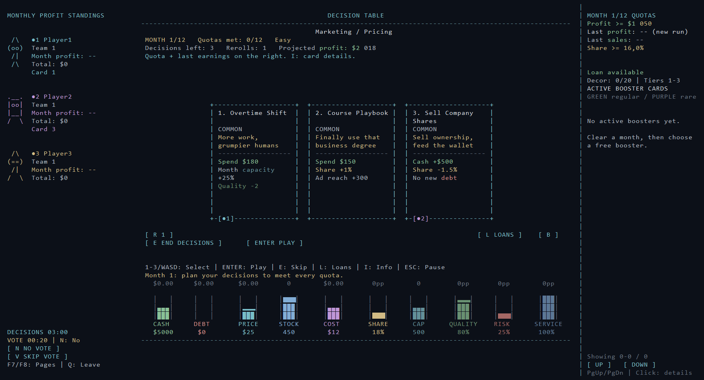
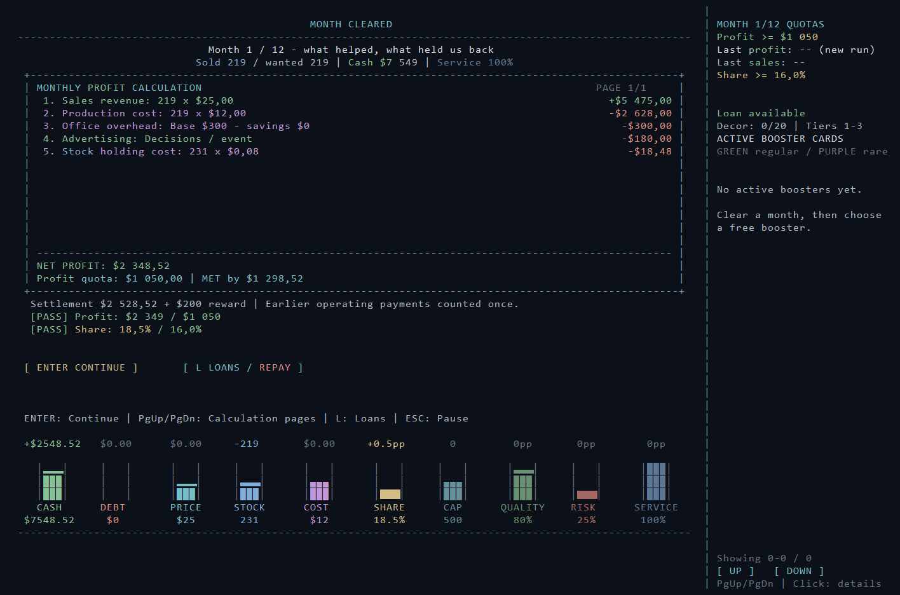
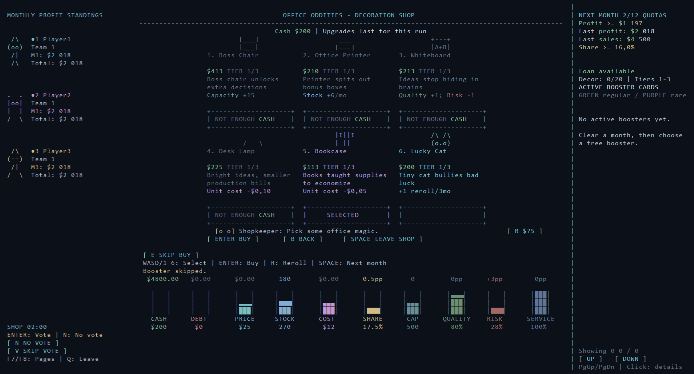
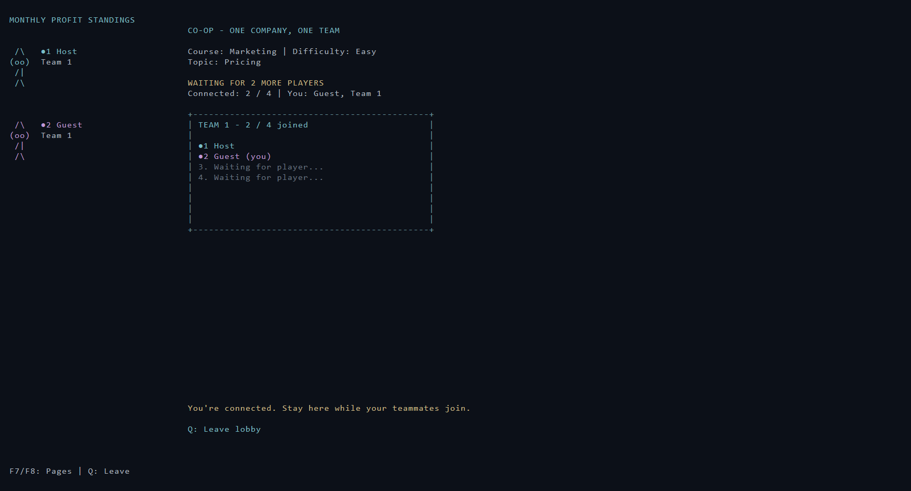

# TranslateUni

**A business strategy game about making tough calls, learning how those calls affect a company, and trying to keep it alive for a full year.**

TranslateUni turns business basics into a playful, Balatro-inspired card game. Each month, choose from decisions such as pricing, marketing, production and customer service. Your choices change the company’s cash, stock, costs, quality, risk and market share. The game then shows the numbers behind the result, so you can see what helped, what held the business back and why the quota was met or missed.

The project began as a way to make business and economics easier to explore through play. Instead of presenting the topics as a list of definitions, TranslateUni lets players try ideas, see their consequences, and learn from both profitable and questionable decisions. Its courses and topics add different business challenges, while the tutorial, learning guide and course library explain the concepts in plain language.

## Screenshots

### Decisions and voting

### Monthly results

### Office decoration shop

### Co-op lobby

## What you do

- Play through 12 monthly quotas. Meet each month’s profit and business targets to finish the year.
- Choose business decision cards, manage optional events, and select boosters after clearing a quota.
- Spend earnings on office decorations and upgrades. Only affordable, available upgrades can be selected.
- Track the company with a persistent statistics board and readable monthly profit calculations.
- Choose from six courses, 60 topics and three difficulty settings. Endless mode unlocks after winning the year.
- Play alone or with friends: CO-OP, two-player Rivalry, or Rivalry CO-OP. Multiplayer runs between players’ computers, with one player hosting the game.

## Controls

| Keys | Action |
| --- | --- |
| **WASD** or **Arrow keys** | Move between choices and cards |
| **1–3** | Select a decision, event or booster card |
| **1–6** | Select an office shop item |
| **Enter** | Play, confirm, buy, or continue |
| **R** | Reroll available choices |
| **E** | Skip optional choices or end the decision phase |
| **N** | Vote no on the current proposal |
| **V** | Submit a neutral vote in team voting |
| **L** / **P** | Open the loan panel / repay a loan |
| **I** | Show card details |
| **Space** | Finish shopping and move on |
| **Esc** | Pause or return to the previous panel |
| **F7 / F8** | Page through multiplayer standings |
| **F9** | Save the current online invite (host) |
| **F10 / F11** | Show or hide connection details / copy the invite or address |
| **Q** | Leave a multiplayer session |

In co-op and team modes, a selection is a vote. Teammates can change their votes before the timer ends. If the vote ties, the tied options go to a short revote. **V** submits a neutral vote; **N** rejects the proposal while leaving the choices visible.

## Getting started

Download the latest release ZIP, extract it, and run `StartGame.cmd` on Windows 10 or 11. The included build requires the .NET 8 runtime. To build from source, open `TranslateUni.sln` in Visual Studio or use the .NET 8 SDK.

For multiplayer, one player hosts and shares the lobby connection details. LAN play works on the same network. Online play uses the host’s computer as the server; direct internet connections may require router port forwarding, or players can connect over a shared VPN.

---

## Release notes — v6.7

Extract this folder and run StartGame.cmd. Windows 10 and 11 are supported; the .NET 8 runtime is required. A compiled build is included in play/. Open TranslateUni.sln to edit the source.

## Monthly accounting, statistics and shop selection in v6.7

Monthly settlement no longer adds sold-unit production costs back into cash. Net profit includes production, overhead, holding costs, operating decisions/events, income and debt charges. Operating expenses or income already applied immediately are reconciled once at settlement. Inventory purchases, capital upgrades, equity funding, loans and repayment remain separate cash movements. The result shows the settlement cash amount and the separate $200 clear reward, and the report cash includes the reward. Loan rescue reports also include their reward.

Statistics retain cents, suppress negative zero and use percentage points (pp) for rate changes: moving from 18% to 19% is +1pp. Monthly change labels stay stable while bars animate; detail panels retain full amounts. Capacity and unit-cost statistics include temporary overtime, supplier and event effects.

Only affordable, unlocked next-tier shop offers can be selected. WASD/arrows and number keys skip unaffordable/maxed offers; those items have no selection hitboxes. Selection is updated after purchases, rerolls and budget changes. If nothing is buyable, the Buy control is replaced with NO BUYABLE ITEMS. Shared multiplayer purchase votes use the same eligibility check.

## Offline verification and firewall alerts in v6.6

The previous port-conflict verification opened the same network-facing listener used by real hosting, which could trigger a Windows firewall alert for a temporary verification build. Normal --self-test now opens no sockets. Network integration checks require the explicit --network-self-test flag, and every test listener is bound to loopback rather than LAN/public interfaces. Existing listeners and peers are closed when their checks or hosting session end. Nothing starts a server when you launch singleplayer or close the game.

An already displayed Windows firewall prompt can be cancelled. Real multiplayer hosting may still request permission because it intentionally accepts connections from other computers. Firewall settings and existing rules have not been changed by this update.

## Hidden connection details and click-to-copy in v6.5

LAN join addresses and translateuni:// online invites start hidden. Press F10 or click SHOW / HIDE to toggle their visibility. The address / invite entry field is also hidden by default; typing and pasting still work normally. The host's lobby visibility toggle reveals both its LAN address and online invite together.

Press F11 or click COPY INVITE to copy the complete online invite while it is hidden or visible. Clicking any displayed line of a wrapped invite copies the whole code, not just that line. LAN hosts can copy a usable IP:port address with F11 / COPY ADDRESS or by clicking the revealed address. A confirmation appears after copying. F9 still saves the host's complete online invite to data/online-invite.txt. Clipboard copying uses the Windows text clipboard; if unavailable, show or save the invite instead.

## Team selection inside the lobby in v6.4

Team selection appears only in Rivalry CO-OP, after connecting to the lobby. Both hosts and guests can inspect the rosters and use 1 / 2 or click JOIN TEAM to choose a company. The first player on each team is its captain and can adjust its slots with the lobby +/- buttons (1-4 players, never fewer than the teammates already present). Players may switch to another team with space before the game starts. The host cannot start while a connected player is still choosing a team. CO-OP and two-player Rivalry assign companies automatically.

LAN hosting now accepts an optional port and tries up to ten nearby alternatives if that port is occupied. Share the full IP:port address shown in the lobby so guests connect to the correct server. Online hosting retains its exact invite port; if occupied, join the existing host or use a different port in the public-address field and forward that port. Failed listeners are closed. Everyone must use v6.7: its updated lobby protocol rejects older versions.

## Joining, waiting and neutral voting in v6.3

Host / Join, LAN / Online and Connect have clickable buttons. Player counts use visible +/- buttons, LEFT / RIGHT to adjust and UP / DOWN to choose a team. Counts include yourself. CO-OP guests simply join the host's shared company; Rivalry CO-OP captains set their own team's size inside the lobby. The lobby shows team rosters, empty slots, your team, course and difficulty, the exact number of missing players and when guests are waiting for the host to start.

N / NO VOTE opposes the current proposal. V / SKIP VOTE stays neutral: it counts as a submitted response, so everyone can finish voting early, but adds no vote for or against any option. Players can change either response before voting finishes. If everyone stays neutral, only the ballot is cleared; the cards, actions, statistics and phase remain unchanged. E retains its explicit skip/end-phase behavior.

Whenever someone casts No vote, every option remains visible in its original position during that ballot's revote, including cards, loan offers, shop items and action controls. Excluded choices are dimmed and disabled. This is a general rule, even when No is not one of the highest-scoring choices. Without any No votes, revotes retain the centered tied-options layout. An accepted loan still shows repayment without collapse or suction animations.
## Voting, shop and events refinements in v6.1

Each player has a colored numbered dot, matching the symbol next to their name. Their badge appears directly on the card, loan offer, booster or shop item they voted for, or beside the corresponding vote button. Up to eight player badges fit on a card; the final vote is also preserved during the selected-card animation. Readiness votes stay visible while waiting for the other company.

A revote without any No votes removes excluded choices and voting controls. Two tied cards are centered symmetrically with the same two-column gap as the original three-card layout. A single surviving card is centered as well. Shop ties move the surviving items onto a centered shelf. Original option numbers remain unchanged; keyboard navigation skips hidden options and mouse hitboxes follow the new positions. The revote footer explains the tied options and the always-available No vote.

Loans are now a shared voting screen: L first proposes opening it. Once accepted, all teammates see the offers. Borrowing, repayment and leaving the panel are separate votes, and an accepted loan leaves everyone looking at the repayment screen. Viewing offers does not borrow money. The existing one-loan limit and three-month repayment cooldown are unchanged.

Shop prices now compare the extra effect gained from each upgrade tier. Unit-cost savings and per-sale margins use a shared baseline benchmark; duplicate overhead, demand and monthly-stock effects use matching benchmarks across all five tiers. Mixed effects retain their additional utility premiums. The initial Boss Chair price now matches its capacity-only first-tier effect. Example first-tier prices: Desk Lamp $225 versus Bookcase $113; Motivation Art $338 versus Desk Pen $225; Desk Fountain $200 versus Desk Fan $100; Desk Plant $150 versus Neon Sign $225; Desk Calendar $175 versus Office Printer $210. Existing boost strengths and tier unlocks are retained.

Every normal new game uses a fresh cryptographic seed. Decisions, event draws, event outcomes and company headlines have separate deterministic random streams, so decision rerolls and loan browsing cannot bias the first headline. Rivalry teams retain matching seeded events for fairness. Company headlines use a shuffled 12-event bag: every headline appears once before the next cycle, with no repeat across the cycle boundary. Optional event cards retain their rarity weights. Tutorial events remain scripted for teaching.

New Competitor now says "Rival copied your sales pitch." School/homework and bake-sale wording has been replaced with business situations, including Client Appreciation Day, Campaign Backlash, Licensing Windfall and Customer Demand Survey. Numeric event effects are retained.

Validation includes colored badges on cards and controls, eight-player layouts, moved mouse targets, restricted revotes, team loan navigation, final-vote animations, price comparisons at all five tiers, varied seeded Marketing starts, independent event randomness and two complete headline cycles. Card, loan, shop and skip voting screens were visually inspected.

## Play modes

Student / Team PLAY now opens Singleplayer, CO-OP, Rivalry (2 player), or Rivalry CO-OP. Enter a name and choose one of six exact 4 x 4 ASCII avatars. Singleplayer continues to the usual course, topic and difficulty selection.

Multiplayer works between separate computers. Each player runs this version of the game. Choose the same multiplayer mode before connecting. TAB switches between Host and Join; F6 switches between LAN and Online.

- CO-OP: 2-8 players share one company and vote on decisions, optional events, boosters, shop purchases, rerolls, loans, repayments and advancing to the next month.
- Rivalry: two players each run an independent company, starting with the same course, topic, difficulty and random seed.
- Rivalry CO-OP: two competing companies, each controlled by a voting team of 1-4 players. The host uses the +/- controls to set both team counts. The first player to choose each team becomes its captain and can adjust that team's count inside the lobby. Teams may have different counts.

The host selects the course (F1), topic (F2) and difficulty (F3). In the lobby, ENTER starts the match after all chosen slots are filled. Player names must be unique. Rivalry guests join Team 2; Rivalry CO-OP players choose their team inside the lobby with 1 / 2 or JOIN TEAM. CO-OP guests join the shared team.

## LAN connection

On one computer choose Host and press ENTER. Its lobby shows local IP addresses and TCP port 45873. On each other computer choose Join, type the host's LAN IP or DNS name, and press ENTER. Allow TranslateUni through Windows Firewall for the network being used if Windows asks. No router forwarding is needed between computers on the same local network.

## Online connection: the host PC is the server

1. Host: press F6 for Online. Type your public IP address, DNS name, or shared VPN address. An optional :port changes the server's listening port; otherwise it uses TCP 45873. Select course/topic/difficulty and team counts, then press ENTER.
2. For direct internet hosting, forward that TCP port on your router to the host PC's local IP and allow inbound connections to the game in Windows Firewall. Keep the host PC and game running. IPv4 and IPv6/DNS endpoints are supported. IPv6 typically needs an inbound firewall allowance rather than IPv4 NAT forwarding.
3. The lobby displays a translateuni:// invite code. F9 saves the complete code to play/data/online-invite.txt in the compiled build. Share that code with your players.
4. Guests: select the matching mode, switch to Online with F6 and Join with TAB, and paste the entire invite code. In Windows Terminal use Ctrl+Shift+V; in a classic console use Ctrl+V. Press ENTER to connect. In Rivalry CO-OP, choose your team after the lobby appears.
5. The host presses ENTER when the lobby is full.

Connections use managed TLS 1.2 with ECDHE and AES-GCM. The invitation pins the host's SHA-256 certificate fingerprint and contains a random room secret. A new host session creates a new invitation. Credentials stay in memory; nothing is installed in Windows certificate or key stores. Bouncy Castle 2.7.0 and its MIT license are included.

There is no central server or relay. The game cannot bypass your router, ISP carrier-grade NAT, a blocked inbound port, or an unreachable public address. If direct port forwarding is unavailable, put the players on a shared VPN and use the host's VPN address. A private home-network IP alone is not reachable from another household. The game does not change router or firewall settings automatically.

## Timers, votes and standings

The decision phase lasts at most 3 minutes. A company that finishes early waits for the other company before playing its optional events. When both companies finish, they advance immediately. The shared 2-minute shop clock starts when the first company reaches the shop. Both companies can finish early by choosing SPACE. When the shop clock expires, outstanding event/results/news/booster screens advance with optional choices skipped, and the next month starts for surviving companies.

In a voting team, the first vote starts a 20-second countdown. Players may change their vote during that window. Once all connected teammates vote, the result resolves early. The choice with the most votes wins; abstentions do not count. A tie opens a 10-second revote restricted to the tied choices. A second tie cancels the vote without using a card or advancing the phase. N votes to reject the proposal without changing the game. V submits a neutral response that does not influence the winning choice. E votes to skip decisions/events/boosters or reject a shop purchase. Opening loans with L and leaving the loan panel with ESC/E are now team votes, as are borrowing and repayment. SPACE votes to finish shopping. Required result/news screens use ENTER to continue.

Each player's assigned color, avatar, current vote, last settled month's profit and total operating profit appear on the left. CO-OP teammates display their shared company's profit. F7/F8 page through longer player lists. Quotas, booster cards and the statistics board stay on the right/bottom. Timers appear below the left player list so shop prices and card animations stay clear.

Rivalry standings rank quotas cleared first, then total operating profit; equal results are a tie. After the year finishes, teams that cleared all 12 quotas may vote with E to continue into endless mode. All connected eligible teams must agree before continuing together. Endless preserves rapidly rising quotas and unlocks decoration tiers 4-5. SPACE can vote against an endless choice. Q leaves a multiplayer session; when the host leaves, the server closes. If a team loses every connected player, it forfeits. Mid-match reconnection is not supported; disconnected lobby slots can be replaced before starting.

## Existing gameplay and controls

All six courses, 60 topics, three difficulties, 12 monthly quotas, guided tutorial/learning guide, course comparison library, events, company headlines, boosters, 20 upgrade families, loans, profit calculations, statistic feedback and card animations are retained. Loan stacking remains disabled; the three-month cooldown starts after the previous debt is fully repaid. Singleplayer history/settings continue to save locally; multiplayer results are shown in the live standings.

WASD/arrows or 1-3 select cards; ENTER plays/takes/claims. R rerolls; E ends decisions or leaves optional cards. Shop: WASD/1-6 select, ENTER buys, R refreshes, SPACE finishes. L opens borrowing/repayment; P repays. I shows card information; click statistic bars for explanations. PgUp/PgDn page calculations or boosters. ESC pauses or returns to the previous panel. Multiplayer clocks continue while a player views information or pauses.

## Windows 11 fullscreen fix

On Windows 11, startup prefers a dedicated Windows Terminal window using its fullscreen command. It now verifies the actual visible game window against the monitor bounds instead of treating a hidden ConPTY console or launch flag as proof. Startup waits for the window to settle and has a monitor-sized fallback for that game window. Classic Alt+Enter fullscreen is also verified from actual bounds when display-mode flags are incomplete. Redirected IDE terminals can relaunch the game into an interactive host.

If Windows Terminal is unavailable or its launch fails, the game falls back to a dedicated classic console. StartClassicFullscreen.cmd forces that path. StartGame.cmd --windowed opts out of fullscreen. DiagnoseDisplay.cmd saves operating-system, monitor, DPI and console details in play/data/display-diagnostics.txt. On a small/high-DPI monitor, use Ctrl+- in Windows Terminal to fit at least 108 x 42 cells (singleplayer) or 140 x 42 (multiplayer); 172 x 46 is recommended for multiplayer. No persistent Terminal profile settings are edited.

## Validation

Release build: zero warnings/errors. Offline self-test: 7,867 checks. Optional network checks are separately enabled with --network-self-test; prior integration validation covered all 180 course/topic/difficulty campaigns, real LAN TCP packets, real encrypted online host/client streams, wrong server-fingerprint rejection, invitation secrets and endpoint parsing, vote/revote timers, team-size choices, shop/decision barriers, loans, mouse voting, stale-input guards, disconnects and shared endless progression. Fullscreen and queued-input/palette tests passed on this Windows 10 machine. Rendered multiplayer screens were visually inspected at 140 x 42 and 172 x 46.

Internet routing between two physical computers and the Windows 11 GUI path need confirmation on those machines; local socket/TLS tests do not verify a router's port forwarding or a particular Windows 11 installation.

